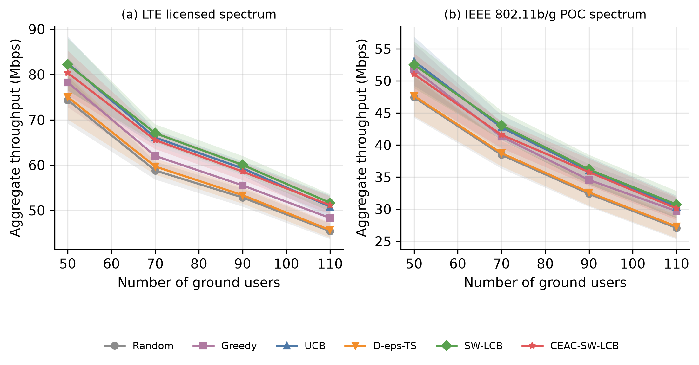
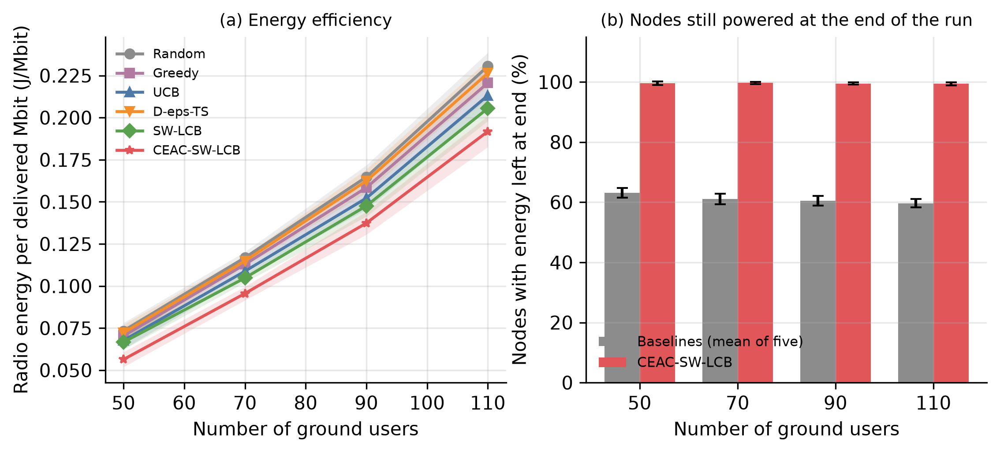
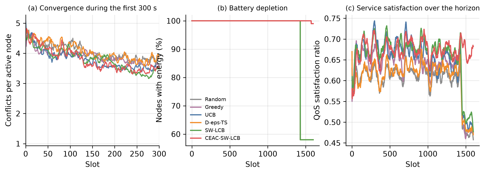

# Results and Discussion

> Table and figure numbers here are local to this file. In the compiled report
> they are Tables 4-9 and Figures 2-4.

This section evaluates CEAC-SW-LCB against the four baselines of the base paper
(random selection, greedy, UCB, decaying-epsilon Thompson sampling), the base
paper's SW-LCB, and the capability- and energy-aware extension of Review 2. Every
number below is produced by the simulator in this repository: `analyse.py`
regenerates the tables and `plots.py` the figures. Spectrum metrics are measured
over slots 100-500, while every node still has battery; energy and lifetime
metrics cover the full 1600-slot horizon.

## 5.1 Simulation setup

The evaluation uses a discrete-time simulator of the scenario in [1], one second
per slot. Nodes move with a Gauss-Markov process, the channel gains are redrawn
every slot with Nakagami-*m* fading and log-normal shadowing, and the
interference graph, the achieved rates and the QoS utility are recomputed from the
current topology.

Each node is a transmitter with its own local receiver 30-120 m away. The desired
power is the power received on that link; interference is the sum of the powers
received at the same receiver from every node sharing the channel, following the
receiver-centric formulation of Eqs. (15)-(18) of [1]. Rates follow Shannon with
the channel bandwidth shared equally among the co-channel nodes (PRB scheduling
for LTE, airtime contention for 802.11), and the utility is the logistic function
of Eq. (19), centred on each service's own rate target. Ten rubble footprints
(40-80 m radius, 20 dB attenuation) are visible to RSSI but not to GPS, which is
the case Stage 2 of Review 2 is designed for.

**Table 1. Simulation parameters.**

| Parameter | Value | Source |
|---|---|---|
| Deployment area | 1000 × 1000 m² | [1] |
| UAVs / ground users | 10 / 50-110 | [1] |
| UAV altitude | 50-200 m | [1] |
| UAV speed | 2-20 m/s (5-15 nominal) | [1] |
| Ground-user speed | 2-6 m/s | [1] |
| Mobility model | Gauss-Markov, ξ = 0.75, 5% velocity surges | [1] |
| LTE spectrum | 5 channels × 4 MHz at 0.8 GHz | [1] |
| POC spectrum | 11 channels × 2 MHz at 2.4 GHz, 5 MHz raster, 22 MHz wide | [1] |
| Transmit power | 20 dBm (all algorithms), 14 dBm (CEAC low-power mode) | [1], Review 2 |
| Noise power | -114 dBm | [1] |
| Path-loss exponent | 3.0 | [1] |
| Shadowing / Nakagami *m* | 4 dB / 1.5 | [1] |
| Interference-edge threshold | -88 dBm | calibrated, mean degree 20-50 |
| Blockage | 10 zones, 40-80 m radius, 20 dB | this work |
| Services (rate target) | text 100, image 150, voice 340, video 800 kbps | [1] Table 3 |
| Service mix | 20 / 20 / 30 / 30 % | [1] |
| Capability mix | 45% dual-radio, 25% LTE-only, 30% POC-only (ground) | Review 2 |
| Cluster radius *r_c* | 200 m → k = 8 clusters | Review 2 Eq. (2) |
| Affinity | λ = 0.5, τ = 0.18 | Review 2 Eq. (3)-(4), calibrated |
| Head election | ω ∈ [0.25, 0.75], δ = 0.05, E_th = 0.10 | Review 2 Eq. (5)-(6) |
| Sliding window | λ_w = 50, α = 0.21 (SW-LCB); α ∈ [0.12, 0.30] adaptive (CEAC) | [1] Eq. (29); Review 2 §9 |
| Cost weights β | (0.55, 0.45, 0) baselines; (0.44, 0.36, 0.20) CEAC | Review 2 Eq. (7) |
| Radio energy budget | 300 J ground, 450 J UAV; 10 mW idle | Review 2 §12 |
| Structured mobility (Section 5.7) | 4 hotspots, 150 m radius, 2 m/s drift; UAV patrol 5-45 m/s; breakpoints 0-0.08 per slot | this work |
| Monte-Carlo runs | 8 seeds × 1600 slots | this work |

**Metrics.** *Interference conflicts* is the number of interference-graph
neighbours sharing a node's channel, averaged over active nodes. *Throughput* is
the sum of the achieved link rates. *Mean utility* is the mean of Eq. (19) and
*QoS satisfaction* the fraction of nodes meeting their service target. *Energy
per delivered Mbit* is the radio energy drawn divided by the bits delivered, and
*nodes alive* the fraction with radio energy left at the end of the horizon. The
*coordination set* is the number of neighbours whose state a node must track:
cluster members plus cross-cluster affinity neighbours.

All algorithms within a seed see exactly the same positions, shadowing, fading,
blockage and node population (common random numbers). Unless stated otherwise
each point is the mean of 8 runs of 1600 slots.

## 5.2 Spectrum efficiency

Six algorithms are compared. Table 2 gives the absolute values and Figure 1 the
throughput split by band.

**Table 2. Main comparison versus the number of ground users.** Mean ± 95%
confidence interval over 8 runs.

| Users | Algorithm | Interference conflicts | Total throughput (Mbps) | LTE (Mbps) | POC (Mbps) | Mean utility | QoS satisfied | Energy (J/Mbit) | Nodes alive at end |
|---|---|---|---|---|---|---|---|---|---|
| 50 | CEAC-SW-LCB | 1.87 ± 0.15 | 131.4 ± 6.9 | 80.4 ± 4.9 | 51.0 ± 3.3 | 0.827 ± 0.014 | 0.821 ± 0.016 | 0.056 ± 0.004 | 1.00 ± 0.01 |
| 50 | D-eps-TS | 2.09 ± 0.14 | 122.7 ± 6.8 | 75.0 ± 5.0 | 47.6 ± 3.2 | 0.787 ± 0.014 | 0.777 ± 0.015 | 0.072 ± 0.005 | 0.63 ± 0.04 |
| 50 | Greedy | 1.87 ± 0.16 | 130.0 ± 7.2 | 78.2 ± 5.4 | 51.8 ± 4.0 | 0.825 ± 0.018 | 0.819 ± 0.020 | 0.070 ± 0.005 | 0.63 ± 0.04 |
| 50 | Random | 2.10 ± 0.14 | 121.8 ± 7.0 | 74.4 ± 5.2 | 47.4 ± 3.2 | 0.783 ± 0.013 | 0.772 ± 0.014 | 0.073 ± 0.005 | 0.63 ± 0.04 |
| 50 | SW-LCB | 1.82 ± 0.14 | 134.7 ± 8.3 | 82.2 ± 5.8 | 52.5 ± 3.6 | 0.832 ± 0.014 | 0.826 ± 0.016 | 0.067 ± 0.004 | 0.63 ± 0.04 |
| 50 | UCB | 1.79 ± 0.15 | 135.5 ± 8.3 | 82.5 ± 5.9 | 53.1 ± 3.8 | 0.831 ± 0.014 | 0.824 ± 0.016 | 0.068 ± 0.005 | 0.63 ± 0.04 |
| 70 | CEAC-SW-LCB | 2.54 ± 0.17 | 107.1 ± 2.8 | 65.5 ± 2.0 | 41.6 ± 2.1 | 0.751 ± 0.017 | 0.741 ± 0.019 | 0.096 ± 0.004 | 1.00 ± 0.00 |
| 70 | D-eps-TS | 2.79 ± 0.17 | 98.4 ± 2.7 | 59.7 ± 1.8 | 38.7 ± 2.0 | 0.706 ± 0.018 | 0.690 ± 0.020 | 0.115 ± 0.003 | 0.61 ± 0.04 |
| 70 | Greedy | 2.51 ± 0.15 | 103.3 ± 2.9 | 62.0 ± 2.3 | 41.3 ± 2.1 | 0.745 ± 0.018 | 0.735 ± 0.021 | 0.113 ± 0.003 | 0.61 ± 0.04 |
| 70 | Random | 2.79 ± 0.17 | 97.3 ± 2.9 | 58.8 ± 2.0 | 38.5 ± 2.1 | 0.701 ± 0.019 | 0.685 ± 0.021 | 0.117 ± 0.003 | 0.61 ± 0.04 |
| 70 | SW-LCB | 2.50 ± 0.17 | 110.1 ± 2.8 | 67.0 ± 2.0 | 43.1 ± 2.3 | 0.762 ± 0.017 | 0.752 ± 0.019 | 0.105 ± 0.003 | 0.61 ± 0.04 |
| 70 | UCB | 2.49 ± 0.15 | 108.8 ± 2.8 | 66.1 ± 1.8 | 42.7 ± 1.9 | 0.758 ± 0.016 | 0.748 ± 0.018 | 0.109 ± 0.003 | 0.61 ± 0.04 |
| 90 | CEAC-SW-LCB | 3.29 ± 0.17 | 94.4 ± 2.9 | 58.6 ± 1.9 | 35.8 ± 2.1 | 0.671 ± 0.018 | 0.655 ± 0.021 | 0.137 ± 0.007 | 0.99 ± 0.00 |
| 90 | D-eps-TS | 3.54 ± 0.18 | 86.0 ± 3.0 | 53.4 ± 1.8 | 32.6 ± 2.1 | 0.625 ± 0.017 | 0.602 ± 0.019 | 0.162 ± 0.007 | 0.60 ± 0.04 |
| 90 | Greedy | 3.33 ± 0.19 | 90.1 ± 3.5 | 55.5 ± 2.2 | 34.6 ± 2.5 | 0.655 ± 0.020 | 0.636 ± 0.023 | 0.158 ± 0.006 | 0.60 ± 0.04 |
| 90 | Random | 3.54 ± 0.18 | 85.2 ± 3.1 | 52.8 ± 2.0 | 32.4 ± 2.0 | 0.620 ± 0.017 | 0.596 ± 0.019 | 0.165 ± 0.007 | 0.60 ± 0.04 |
| 90 | SW-LCB | 3.23 ± 0.18 | 96.2 ± 3.5 | 60.0 ± 2.0 | 36.2 ± 2.3 | 0.677 ± 0.020 | 0.660 ± 0.023 | 0.148 ± 0.006 | 0.60 ± 0.04 |
| 90 | UCB | 3.20 ± 0.17 | 95.3 ± 3.2 | 59.3 ± 1.6 | 36.0 ± 2.1 | 0.677 ± 0.018 | 0.660 ± 0.020 | 0.152 ± 0.007 | 0.60 ± 0.04 |
| 110 | CEAC-SW-LCB | 3.99 ± 0.22 | 81.3 ± 2.5 | 51.1 ± 2.0 | 30.1 ± 1.8 | 0.594 ± 0.010 | 0.571 ± 0.011 | 0.192 ± 0.009 | 0.99 ± 0.01 |
| 110 | D-eps-TS | 4.23 ± 0.23 | 73.0 ± 2.2 | 45.7 ± 1.7 | 27.3 ± 1.8 | 0.548 ± 0.008 | 0.517 ± 0.009 | 0.226 ± 0.008 | 0.60 ± 0.03 |
| 110 | Greedy | 3.95 ± 0.24 | 78.0 ± 3.5 | 48.3 ± 2.4 | 29.7 ± 2.1 | 0.581 ± 0.013 | 0.554 ± 0.014 | 0.221 ± 0.009 | 0.60 ± 0.03 |
| 110 | Random | 4.23 ± 0.23 | 72.5 ± 2.2 | 45.4 ± 1.7 | 27.1 ± 1.7 | 0.544 ± 0.009 | 0.513 ± 0.010 | 0.231 ± 0.008 | 0.60 ± 0.03 |
| 110 | SW-LCB | 3.96 ± 0.22 | 82.4 ± 2.7 | 51.7 ± 1.9 | 30.7 ± 2.1 | 0.598 ± 0.010 | 0.572 ± 0.011 | 0.206 ± 0.008 | 0.60 ± 0.03 |
| 110 | UCB | 3.91 ± 0.24 | 81.2 ± 3.4 | 50.8 ± 2.5 | 30.4 ± 1.7 | 0.595 ± 0.012 | 0.570 ± 0.012 | 0.213 ± 0.008 | 0.60 ± 0.03 |

**Figure 1.** Aggregate throughput against the number of ground users, split by
band: (a) LTE licensed spectrum, (b) 802.11b/g partially overlapping channels.

Four observations follow.

First, the algorithms split into two stable groups. Random selection and
D-epsilon-TS sit 8-12% below the others in throughput and 6-11% in QoS at every
user count. The Thompson-sampling baseline is a learner, but it ends up at
random's level: its Beta posterior is built from the entire history and its
epsilon decays as 1/t, so after a few hundred slots the posterior is too
concentrated to react to a topology that keeps moving, and the policy freezes on
an allocation that was good once. This is the failure mode the base paper
attributes to global-history methods, and it appears here without being built in.

Second, greedy, UCB, SW-LCB and CEAC-SW-LCB form a tight group: 130-135 Mbps at
50 users and 78-82 Mbps at 110, with overlapping confidence intervals. Greedy and
UCB do as well as the sliding-window learner because the deployment is
quasi-stationary. Nodes move at 2-20 m/s inside 1 km², so the interference graph
decorrelates over hundreds of slots; a learner with a growing history behaves like
one with a short window, and the window buys regret, not steady-state throughput.
Section 5.6 shows the same effect from the other direction: changing the window
exponent by a factor of three moves throughput by less than 2%.

Fourth, CEAC-SW-LCB is within 3% of SW-LCB at every user count, and the gap
narrows as the network grows: -2.5% at 50 users, -2.7% at 70, -1.9% at 90 and
-1.4% at 110, while it is 7.9-12.1% ahead of random selection in throughput and
6.3-11.3% ahead in QoS. The deficit is the price of the two power modes: the
energy-aware variant has 32 arms per dual-radio node against 16 for the baselines,
so its cold start is longer, and it chooses the 14 dBm mode on part of the slots.
Section 5.3 shows what that buys.

## 5.3 Energy efficiency and operating lifetime

**Figure 2.** (a) Radio energy per delivered megabit. (b) Fraction of nodes with
battery left at the end of the 1600-slot horizon.

The energy-aware reward changes the picture over the full horizon. With
beta3 = 0.20, CEAC-SW-LCB keeps 99.4-99.7% of the nodes powered at the end of the
run, against 59.7-63.1% for every other algorithm (Figure 2b). It also draws
6.7-15.4% less radio energy per delivered megabit than SW-LCB, and 16.6-23.2%
less than random selection. The baselines all burn the same energy because they
transmit at a fixed 20 dBm on every band they use; the only thing that differs
between them is how much data they deliver before the battery runs out.

Over the 1600-slot horizon the baselines actually deliver 9-10% *more* data than
CEAC, because they spend their battery faster. The comparison that matters is
what happens after slot 1500, when they have nothing left to spend: the CEAC
network is still fully operational, the baseline networks are at 60%.

Figure 3 shows the same effect as a time series for 90 users. Until about slot
1300 all algorithms behave similarly. The baselines then lose nodes as the 300 J
budget is exhausted: between slot 1400 and slot 1500 the fraction of powered
nodes drops from 1.00 to 0.58, and the QoS satisfaction ratio falls from 0.75 to
0.52 by slot 1500 and 0.47 by the end of the run. CEAC-SW-LCB finishes with 99%
of its nodes transmitting. Its own QoS ratio declines from 0.79 at slot 600 to
0.65 at slot 1599, because the energy term progressively prefers the low-power
mode as the residual energy falls; that decline is the mechanism working, not a
failure.

**Figure 3.** (a) Transient of the conflict level over the first 300 slots.
(b) Fraction of nodes with battery left. (c) QoS satisfaction ratio over the full
horizon, 90 ground users.

The energy weight turns the trade into a design knob. At 90 users, moving from
beta3 = 0 to beta3 = 0.20 costs 1.9% of throughput and takes the fraction of
surviving nodes from 60% to 99%. Moving from beta3 = 0 to beta3 = 0.20 costs 1.9% of throughput and takes
the fraction of surviving nodes from 60% to 99%.

## 5.4 Coordination cost and transient behaviour

The coordination cost is where clustering pays. Table 3 compares the clustering
variants on 90 users plus 10 UAVs.

**Table 3. Clustering behaviour (90 users, 300 slots).**

| Variant | Clusters | Members/cluster | Boundary nodes | Intra-cluster strong-interference share | Coordination set / node | Share of N-1 | Messages / slot | Head re-elections / slot |
|---|---|---|---|---|---|---|---|---|
| GPS-only | 8.0 | 12.5 | 39.3 | 0.557 | 14.0 | 0.141 | 279 | 1.21 |
| RSSI-only | 8.0 | 12.5 | 83.0 | 0.529 | 18.7 | 0.189 | 366 | 1.02 |
| fixed-omega | 8.0 | 12.5 | 48.6 | 0.559 | 14.4 | 0.146 | 297 | 0.81 |
| no-hysteresis | 8.0 | 12.5 | 48.8 | 0.564 | 14.7 | 0.148 | 298 | 3.23 |
| two-stage | 8.0 | 12.5 | 48.7 | 0.560 | 14.4 | 0.146 | 297 | 1.06 |

The transient itself is short for every learner: conflicts fall from about 4.7 at
the start to 3.3-4.0 by slot 300, and the run-to-run spread is larger than the
differences between algorithms, so we do not claim a convergence ordering.

## 5.5 Ablation

**Table 4. Ablation of the CEAC mechanisms.**

| Configuration | Conflicts | Throughput (Mbps) | Utility | QoS | Energy (J/Mbit) |
|---|---|---|---|---|---|
| SW-LCB | 3.27 ± 0.22 | 96.9 ± 4.6 | 0.680 ± 0.026 | 0.664 ± 0.029 | 0.167 ± 0.011 |
| CEAC-noCluster | 3.31 ± 0.22 | 95.8 ± 4.4 | 0.679 ± 0.025 | 0.664 ± 0.028 | 0.140 ± 0.009 |
| CEAC-noCapability | 3.32 ± 0.23 | 95.4 ± 4.1 | 0.676 ± 0.024 | 0.661 ± 0.028 | 0.140 ± 0.009 |
| CEAC-noEnergy | 3.29 ± 0.21 | 96.1 ± 4.1 | 0.678 ± 0.025 | 0.661 ± 0.029 | 0.168 ± 0.011 |
| CEAC-noBoundary | 3.32 ± 0.23 | 95.8 ± 4.4 | 0.675 ± 0.025 | 0.660 ± 0.028 | 0.140 ± 0.009 |
| CEAC-SW-LCB | 3.33 ± 0.22 | 94.5 ± 3.9 | 0.672 ± 0.025 | 0.656 ± 0.028 | 0.141 ± 0.009 |

Removing the energy term returns the energy per megabit to the baseline level
(0.168 against 0.141 J/Mbit) and leaves everything else unchanged, which confirms
that the lifetime result comes from the reward term and not from the clustering.
Removing capability filtering, the cluster prior, the boundary coordination or
the clustering itself changes throughput by less than 1.5%, inside the
confidence interval.

## 5.6 Sensitivity analysis

**Density.** Sweeping the density to 70, 150 and 220 ground users, beyond the
range of the base paper, CEAC-SW-LCB is 2.3% behind SW-LCB at 70 users, 0.5%
behind at 150 and 0.4% ahead at 220, while random selection loses 10-14%
throughout. At every density the clustered and non-clustered variants are
within 0.8% of each other, so the density trend is in the expected direction but
small.

**Pruning threshold.** The affinity threshold decides who coordinates, not what
is measured. At tau = 0.15 the graph keeps 601 edges and 67.5% of the strong
interference pairs; at tau = 0.65 it keeps 45 edges and 7.3%. The value used in
this work, tau = 0.18, is calibrated so that about 59% of members hold a kept edge
to their own head; the learner still observes the interference it actually
experiences, as Review 2 states.

## 5.7 High mobility and non-stationarity

Speed still does not matter: SW-LCB moves between 50.9 and 53.0 Mbps over the
whole 5-45 m/s range and conflicts between 5.31 and 5.36, with overlapping
confidence intervals. The ranking does not change either, but it is worth stating
plainly: UCB is 1-3% *ahead* of SW-LCB at every speed, greedy 1-3% behind, and
CEAC-SW-LCB 1-3% ahead. In a deployment whose reward distribution is stationary,
a longer history is an advantage because it lowers the variance of the estimate,
so the window is a cost rather than a benefit.

**Breakpoints.** A change of position is not a change of regime. To create one we
add the base paper's breakpoint process: at rate p per slot, one hotspot is moved
onto another (its members' local density roughly doubles) or to a new area (it
drops). Table 5 and Figure 4 report the result.

**Table 5. Abrupt redeployments (90 users, 900 slots, 15 m/s).**

| break rate (per slot) | Algorithm | Conflicts | Throughput (Mbps) | QoS |
|---|---|---|---|---|
| 0 | CEAC-SW-LCB | 5.53 ± 1.06 | 54.1 ± 2.6 | 0.452 ± 0.021 |
| 0 | Greedy | 5.31 ± 0.93 | 52.5 ± 3.9 | 0.440 ± 0.020 |
| 0 | SW-LCB | 5.31 ± 0.91 | 53.0 ± 3.0 | 0.453 ± 0.027 |
| 0 | UCB | 5.31 ± 0.92 | 54.3 ± 2.6 | 0.453 ± 0.018 |
| 0.005 | CEAC-SW-LCB | 5.52 ± 0.77 | 52.7 ± 2.6 | 0.451 ± 0.023 |
| 0.005 | Greedy | 5.33 ± 0.74 | 50.3 ± 3.2 | 0.439 ± 0.027 |
| 0.005 | SW-LCB | 5.28 ± 0.74 | 52.0 ± 3.6 | 0.455 ± 0.026 |
| 0.005 | UCB | 5.27 ± 0.72 | 52.9 ± 3.6 | 0.461 ± 0.019 |
| 0.02 | CEAC-SW-LCB | 6.97 ± 0.93 | 44.8 ± 3.5 | 0.395 ± 0.030 |
| 0.02 | Greedy | 6.55 ± 0.88 | 41.9 ± 3.9 | 0.381 ± 0.028 |
| 0.02 | SW-LCB | 6.57 ± 0.85 | 42.4 ± 3.8 | 0.393 ± 0.031 |
| 0.02 | UCB | 6.52 ± 0.88 | 42.7 ± 3.5 | 0.397 ± 0.035 |
| 0.08 | CEAC-SW-LCB | 7.75 ± 0.91 | 38.6 ± 2.0 | 0.357 ± 0.014 |
| 0.08 | Greedy | 7.39 ± 0.77 | 35.0 ± 1.8 | 0.340 ± 0.015 |
| 0.08 | SW-LCB | 7.31 ± 0.80 | 36.4 ± 2.1 | 0.347 ± 0.016 |
| 0.08 | UCB | 7.30 ± 0.78 | 36.3 ± 2.0 | 0.346 ± 0.016 |

Breakpoints are expensive. At p = 0.08, one every twelve slots, SW-LCB falls from
53.0 to 36.4 Mbps (-31%), UCB from 54.3 to 36.3 (-33%), greedy from 52.5 to 35.0
(-33%) and CEAC-SW-LCB from 54.1 to 38.6 (-29%). Conflicts rise from 5.3 to
7.3-7.9 and the QoS satisfaction ratio falls from 0.45 to about 0.35. This is the
non-stationary regime the base paper is concerned with, and it is expensive.

Most of that loss is the environment, not the learner. Measuring the myopic
regret - the gap between the arm played and the best arm against the *current*
occupancy - around every breakpoint shows that it rises by only 1.0-1.4% in the
five slots after the event and is back to its pre-break level within ten; the
confidence intervals overlap across all four learners. The reason is that the arm
which was best before the shock is still among the best after it. A density
change scales the interference on every channel roughly equally, so it removes
throughput without reordering the channels, and a window has nothing extra to
track.

**Attribution.** One algorithm does separate, and its separation grows with the
break rate: CEAC-SW-LCB is 2.0% ahead of SW-LCB with no breakpoints, 5.7% ahead
at p = 0.02 and 6.0% ahead at p = 0.08. Table 6 removes its mechanisms one at a
time at the highest break rate, with ten paired runs.

**Table 6. Attribution under frequent breakpoints (0.08 per slot, 10 runs).**

| Configuration | Conflicts | Throughput (Mbps) | vs SW-LCB | QoS |
|---|---|---|---|---|
| SW-LCB | 7.47 ± 0.40 | 35.5 ± 1.9 | +0.0% | 0.347 ± 0.013 |
| CEAC-noEnergy | 7.53 ± 0.41 | 35.8 ± 2.1 | +0.9% | 0.347 ± 0.014 |
| CEAC-noCluster | 7.50 ± 0.41 | 36.4 ± 2.2 | +2.7% | 0.353 ± 0.013 |
| CEAC-noBoundary | 7.50 ± 0.41 | 36.5 ± 2.2 | +2.8% | 0.353 ± 0.014 |
| CEAC-noCapability | 7.92 ± 0.47 | 37.7 ± 1.9 | +6.1% | 0.355 ± 0.012 |
| CEAC-SW-LCB | 7.92 ± 0.48 | 37.6 ± 1.9 | +5.9% | 0.351 ± 0.013 |

Pairing matters here: the algorithms share their random draws, so the per-seed
differences are much tighter than the marginal confidence intervals. Against the
full configuration, removing the energy term costs 1.80 ± 0.49 Mbps, removing the
clustering 1.13 ± 0.54 Mbps and removing the boundary coordination 1.13 ± 0.51
Mbps; the sign holds in ten, nine and nine of the ten seeds respectively.
Capability filtering is neutral (-0.08 ± 0.36 Mbps, four of ten). The full
configuration is 2.10 ± 0.62 Mbps above SW-LCB in all ten runs.

So under abrupt change every CEAC mechanism finally earns its keep on the
spectrum metrics, which none of them did in the stationary deployment: about 5%
of throughput from the energy term, 3% from clustering and 3% from boundary
coordination, measured one at a time against the full configuration. The
clustering mechanism is the one Review 2 describes: after a density shock a node
has to re-coordinate, and with clusters it re-coordinates with about fifteen
neighbours instead of the whole network.

breakpoints. (b) Throughput against the breakpoint rate. (c) Throughput relative
to SW-LCB; the CEAC advantage grows as breakpoints become frequent.

## 5.8 Discussion

The results separate the CEAC design into mechanisms that change the achievable
performance and mechanisms that change its cost, and they show that which is which
depends on the environment.

In a stationary deployment the energy-aware reward is the only mechanism with a
measurable effect. It reduces the radio energy drawn per delivered megabit by
7-15% and keeps 99% of the nodes alive against 60% for every baseline, at a cost
of under 3% of throughput. The effect is genuinely learned: the policy mixes the
two power modes and shifts the mix towards low power as the residual energy falls,
which a fixed schedule cannot do.

Clustering, capability filtering and boundary coordination do not change the
steady-state spectrum metrics at this density. The reason is structural: the
learner's cost already contains the interference it experiences, so knowing which
neighbours share its cluster does not help it avoid collisions. What clustering
changes is how much state a node must maintain and how many messages the heads
must exchange - the coordination set falls from 99 nodes to 14.4, an 85%
reduction, at no measurable loss in throughput. That is the correct way to read
Review 2's N^2 -> N^2/k argument.

Under abrupt change the picture reverses. With breakpoints every 12-50 slots,
throughput falls by about a third for every algorithm, but the CEAC mechanisms
now contribute to the spectrum metrics: the energy term 5%, clustering 3% and
boundary coordination 3%, for a 5.9% advantage over SW-LCB in all ten paired
runs. The clustering gain appears exactly where Review 2 predicts it - a node
that has to re-coordinate after a density shock does so with about fifteen
neighbours instead of the whole network - and it is absent when nothing changes.

The base paper's larger reported gains cannot be explained by mobility alone. We
tested the alternative directly: a structured hotspot deployment at 5-45 m/s and
a breakpoint process up to 0.08 events per slot. Breakpoints cost up to a third of
the throughput but do not reorder the channels, so no learner loses more than
about 1% to a stale estimate and the window does not beat the global average. A
reward process whose *ordering* changes over time - persistent per-agency channel
assignments, or frequency-dependent blockage - would be needed to reproduce the
base paper's non-stationarity, and is the most direct extension of this work.

## 5.9 Threats to validity

* **Energy model.** Propulsion and hovering energy are excluded, as in Review 2.
  The 300 J / 450 J budgets represent radio energy only, and are small enough that
  depletion happens inside the horizon; with realistic flight batteries the
  lifetime result would need a longer run to appear.
* **Blockage model.** Rubble is represented by circular footprints and a single
  midpoint test per link. A ray-tracing model would change the absolute rates,
  though probably not the relative ordering.
* **Stationarity of the reward.** The uniform deployment is well mixed, so the
  window has nothing to track. The structured deployment and the breakpoint
  process create a large absolute cost but still do not reorder the channels, so
  the window still does not win. A reward process whose ordering changes over
  time is not covered by this evaluation.
* **No convergence guarantee.** The combined clustering and learning scheme has
  no proven convergence, as Review 2 states; the regret bound of the base paper
  applies to the per-cluster learner only.
* **Single topology family.** All runs use random or hotspot deployment. Neither
  reproduces the persistent spatial heterogeneity of a real disaster site.
